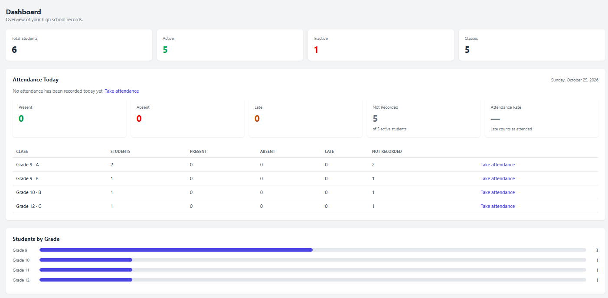
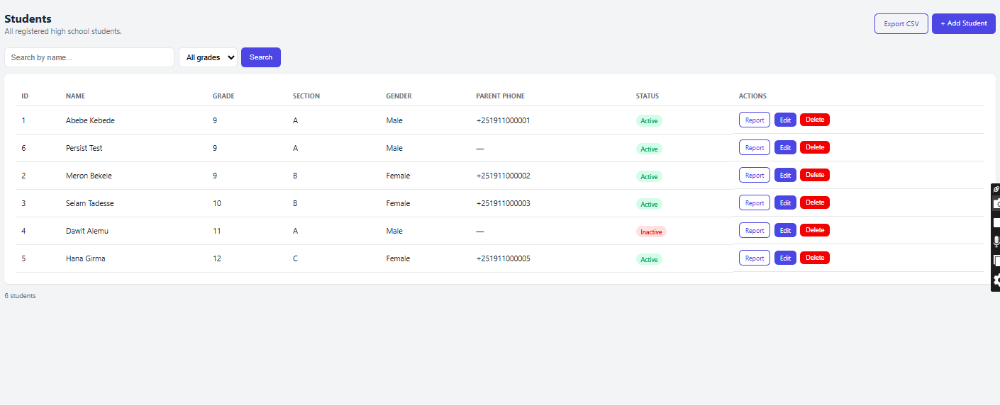
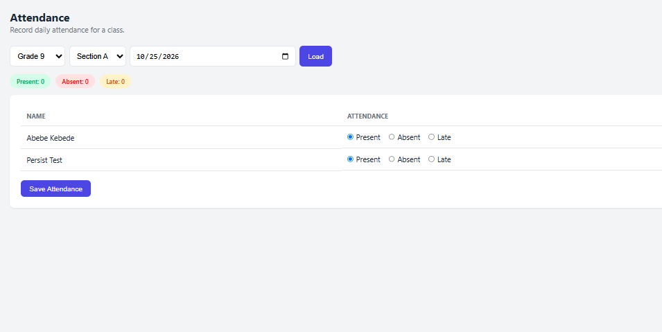
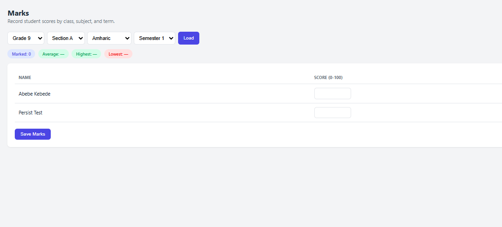
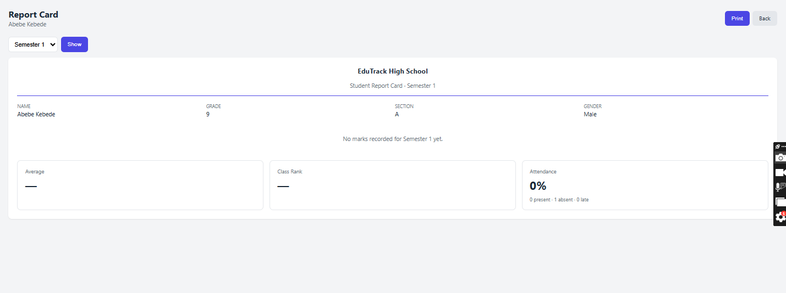
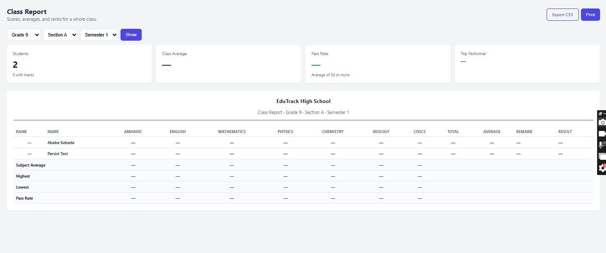
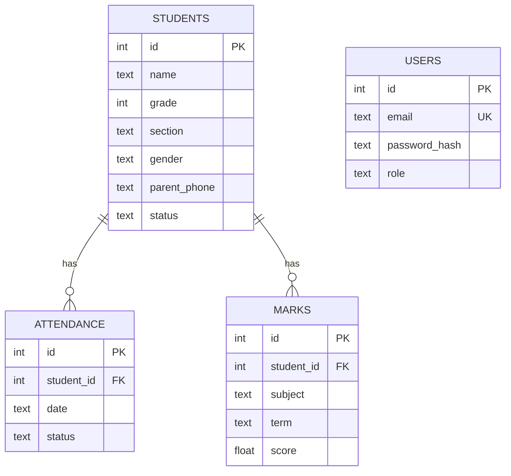

# 🎓 EduTrack

> A high school management system: students, attendance, marks, and report cards.


**🔗 Live Demo:** https://edutrack-6jlc.onrender.com

> The demo runs on a free hosting plan, so the first load can take up to a
> minute while the server wakes up. Register with any email to try it (new
> accounts get the **Teacher** role). **Please use fake data only.**

EduTrack is a full-stack web application built with **Flask** and
**PostgreSQL**. It started as a learning project and grew into a portfolio
piece that covers routing, templating, database design, authentication,
role-based access, validation, pagination, CSV export, automated testing, and
deployment.

## Screenshots

<table>
  <tr>
    <td width="50%"><br><sub><b>Dashboard</b> - statistics, today's attendance, and students by grade</sub></td>
    <td width="50%"><br><sub><b>Students</b> - search, grade filter, and pagination</sub></td>
  </tr>
  <tr>
    <td width="50%"><br><sub><b>Attendance</b> - Present, Absent, or Late for each class</sub></td>
    <td width="50%"><br><sub><b>Marks</b> - scores by subject and semester, with class statistics</sub></td>
  </tr>
  <tr>
    <td width="50%"><br><sub><b>Report card</b> - marks, average, class rank, and attendance (printable)</sub></td>
    <td width="50%"><br><sub><b>Class report</b> - every student's scores, rank, and result</sub></td>
  </tr>
</table>

## Features

**Students**
- Student records: grade (9-12), section, gender, parent phone, and status
- Search by name, filter by grade, and a paginated list (20 per page)
- Add, edit, and delete students (admin only)

**Attendance**
- Daily attendance per class: Present, Absent, or Late
- Dashboard summary for *today*: counts, attendance rate, and which classes
  still need their attendance taken

**Marks and reports**
- Marks by subject and semester, with class average, highest, and lowest
- Printable **report card** per student: marks, average, class rank, and
  attendance rate
- **Class report**: every student's scores, total, average, rank, and
  pass/fail, plus statistics for each subject

**Export**
- **CSV export** for students, class reports, marks, and attendance
- Opens correctly in Excel (including Amharic names) and is protected against
  spreadsheet formula injection

**Accounts and security**
- Email registration and login with securely hashed passwords
- Persistent sessions (users stay signed in for 7 days)
- Role-based access: **admin** and **teacher**
- Server-side validation, flash messages, and a custom 404 page

## Roles

| Capability                               | Admin | Teacher |
|------------------------------------------|:-----:|:-------:|
| View dashboard, students, and reports    |  Yes  |   Yes   |
| Take attendance and enter marks          |  Yes  |   Yes   |
| Export a class report                    |  Yes  |   Yes   |
| Add, edit, and delete students           |  Yes  |   No    |
| Export students, marks, and attendance   |  Yes  |   No    |
| Manage users and roles                   |  Yes  |   No    |

The **first account that registers becomes the admin**; later accounts start
as teachers. An admin cannot change their own role, so there is always at
least one admin.

## Tech Stack

| Layer      | Technology                                          |
|------------|-----------------------------------------------------|
| Backend    | Python 3, Flask                                     |
| Database   | PostgreSQL in production (Neon); SQLite locally     |
| Frontend   | HTML, CSS, Jinja2 templates (no JavaScript framework) |
| Auth       | Werkzeug password hashing, Flask sessions           |
| Testing    | pytest                                              |
| Hosting    | Render (web service) and Neon (database)            |

## Database



Deleting a student also deletes their attendance and marks (`ON DELETE
CASCADE`). A student can have only one mark per subject and semester, and one
attendance record per day.

## Design Decisions

- **One codebase, two databases.** A small `Database` wrapper lets the same
  queries run on SQLite (local development and tests) and PostgreSQL
  (production). Queries use `?` placeholders, converted automatically.
- **Parameterized queries everywhere**, so user input is never placed inside
  SQL text.
- **Fair ranking.** Students with the same average share a rank (1, 1, 3).
  Students with no marks yet are listed last and are not ranked.
- **Honest attendance.** A student with no record for a day is shown as *Not
  Recorded*, never as absent. *Late* counts as attended.
- **School time zone.** "Today" is calculated in Ethiopia's time zone (UTC+3),
  because servers usually run on UTC.
- **Stable pagination.** Results are ordered with the student `id` as a final
  tie-breaker, so no student repeats or disappears between pages.
- **Tests never touch real data.** The test suite always uses a temporary
  SQLite database, even if `DATABASE_URL` is set.

## Project Structure

```
edutrack/
├── app.py              # Flask app: routes, database layer, business logic
├── csv_tools.py        # Safe, Excel-friendly CSV building
├── pagination.py       # Pagination helpers
├── Procfile            # Production start command (gunicorn)
├── requirements.txt    # Python dependencies
├── LICENSE
├── docs/screenshots/   # Images used in this README
├── scripts/
│   └── seed_demo.py    # Generates fake demo data
├── static/css/         # Stylesheet
├── templates/          # Jinja2 HTML templates
└── tests/              # Automated tests (pytest)
```

## Getting Started

### Prerequisites

- Python 3.10 or higher
- Git

### Installation

```bash
git clone https://github.com/tamirataklilu575-ctrl/edutrack.git
cd edutrack
python -m venv venv
```

Activate the virtual environment:

```bash
# Windows (PowerShell)
venv\Scripts\Activate.ps1

# macOS / Linux
source venv/bin/activate
```

Install the dependencies and start the app:

```bash
pip install -r requirements.txt
python app.py
```

Open http://127.0.0.1:5000 and register. Locally the app uses a SQLite file
(`edutrack.db`) that is created automatically. The first account becomes the
admin.

### Demo data (optional)

To fill the app with about 30 fake students, one semester of marks, and recent
attendance:

```bash
python scripts/seed_demo.py
```

It is safe to run twice, and it refuses to write to PostgreSQL unless you pass
`--allow-postgres`.

## Configuration

| Variable       | Purpose                                                        |
|----------------|----------------------------------------------------------------|
| `DATABASE_URL` | PostgreSQL connection string. If it is not set, SQLite is used. |
| `SECRET_KEY`   | Secret used to sign session cookies. Always set it in production. |
| `FLASK_DEBUG`  | Set to `1` for debug mode (local development only).            |

Never commit real secrets. Set them in your hosting provider's dashboard.

## Running Tests

```bash
python -m pytest
```

The suite covers authentication, roles, validation, attendance, marks, report
cards, class reports, CSV export, pagination, and the database layer. It takes
a couple of minutes because password hashing is deliberately slow.

## Deployment

The app runs on [Render](https://render.com) with a free
[Neon](https://neon.com) PostgreSQL database, so data survives restarts.

1. Create a Neon project and copy its connection string.
2. Create a Render **Web Service** from this repository:
   - Build command: `pip install -r requirements.txt`
   - Start command: `gunicorn app:app`
3. Add the environment variables `DATABASE_URL` and `SECRET_KEY`.

The tables are created automatically on first start.

## Security and Limitations

This is a portfolio project, not a finished school system. What it does:

- Passwords are hashed (never stored as plain text)
- Every query is parameterized
- Admin-only pages are checked on the server, not just hidden in the menu
- Login failures use one message, so they do not reveal which emails exist
- CSV files neutralize spreadsheet formulas

What it does **not** have yet:

- CSRF tokens (it relies on `SameSite=Lax` session cookies)
- Email verification or password reset
- Login rate limiting
- Importing or restoring data from CSV (export works as a backup only)
- An audit log of who changed what

Because of this, **do not enter real student data** in the live demo.

## Roadmap

- [x] Authentication with admin and teacher roles
- [x] Students, attendance, and marks
- [x] Report card and class report
- [x] Dashboard attendance summary
- [x] Persistent PostgreSQL storage
- [x] CSV export
- [x] Pagination
- [x] Automated tests
- [ ] CSRF protection
- [ ] Email verification and password reset
- [ ] Import data from CSV
- [ ] Audit log
- [ ] Assign teachers to specific classes

## License

Released under the [MIT License](LICENSE).

## Author

Built by **Aklilu Tamirat** - [GitHub](https://github.com/tamirataklilu575-ctrl)